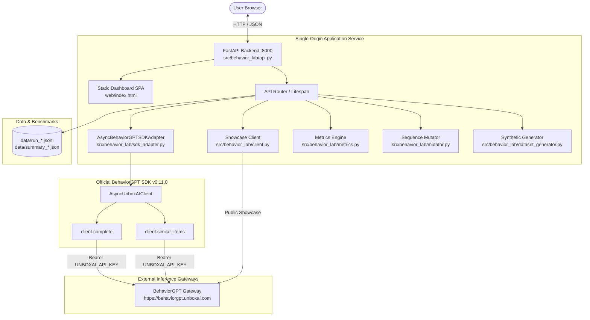

# BehaviorGPT Counterfactual Sensitivity Lab — Behavioral Decision Explorer

> An empirical research workbench and interactive decision explorer investigating sequential counterfactual sensitivity, representation dynamics, and nearest-neighbor item retrieval using the official Unbox AI **BehaviorGPT** foundation model SDK.

[](https://www.python.org/downloads/)
[](https://fastapi.tiangolo.com)
[](https://github.com/Unbox-AI/behaviorgpt)
[](tests/)
[](#5-system-architecture)

---

## Table of Contents

1. [Project Overview & Central Research Question](#1-project-overview--central-research-question)
2. [Research Motivation](#2-research-motivation)
3. [Key Empirical Findings](#3-key-empirical-findings)
4. [Core Features](#4-core-features)
5. [System Architecture](#5-system-architecture)
6. [Technology Stack](#6-technology-stack)
7. [Installation & Local Setup](#7-installation--local-setup)
8. [Environment Configuration](#8-environment-configuration)
9. [Official SDK Integration Deep Dive](#9-official-sdk-integration-deep-dive)
10. [API Reference](#10-api-reference)
11. [Research Metrics Formulation](#11-research-metrics-formulation)
12. [Data, Provenance & Reproducibility](#12-data-provenance--reproducibility)
13. [Testing & Quality Assurance](#13-testing--quality-assurance)
14. [Example Workflow & Walkthrough](#14-example-workflow--walkthrough)
15. [Investigated Case Studies](#15-investigated-case-studies)
16. [Technical Limitations & Future Work](#16-technical-limitations--future-work)
17. [Project Structure](#17-project-structure)
18. [Security & Credential Isolation](#18-security--credential-isolation)
19. [Contributing](#19-contributing)
20. [Acknowledgements](#20-acknowledgements)

---

## 1. Project Overview & Central Research Question

### The Foundation Model Premise

**BehaviorGPT** is Unbox AI's Large Behavioral Model (LBM). Unlike standard language foundation models that predict text tokens or traditional recommendation engines that operate on static collaborative-filtering matrix factorization, BehaviorGPT models user intent directly from chronological event sequences (`View`, `AddToCart`, `Search`, and `Order`) to rank an entire commercial product catalog in a single forward pass.

> **Note on Model Claims & Verification:**  
> Marketing materials describe BehaviorGPT as a 12.5-billion-parameter foundation model ("v4-12.5B") pretrained on 150 billion chronological user actions across retail, payments, and engagement. While these model scale figures are derived from public product announcements and remain unverified by third-party weights audit, the observable characteristics of the service—such as asynchronous SDK interfaces, vector nearest-neighbor retrieval, uncalibrated inner-product similarity scores, and chronological event sequence processing—have been independently validated through direct integration with the official `behaviorgpt==0.11.0` Python SDK.

### The Central Research Question

This research project and interactive decision explorer systematically investigates the following question:

> **"When exactly one action in an ongoing behavioral history is perturbed, how does BehaviorGPT's subsequent recommendation distribution change, if at all?"**

### Scientific Purpose

We measure and quantify **model sensitivity and representation dynamics**:
- **Non-Normative Stance:** This workbench does not assume that recommendations *must* change, that a changed recommendation is inherently superior, or that invariant recommendations signify model failure.
- **Sensitivity vs. Robustness Trade-off:** High sensitivity is desirable when a user exhibits a genuine pivot in commercial intent (e.g., switching from athletic footwear to consumer electronics). Conversely, robustness and invariance are desirable when minor noise occurs (e.g., clicking on an adjacent item without changing underlying purchase intent).

---

## 2. Research Motivation

Modern sequential recommendation architectures face unique representation challenges compared to static recommendation algorithms:

1. **Sequential Sensitivity & Temporal Ordering:**  
   Traditional matrix factorization collapses user histories into static bags-of-items. Autoregressive and transformer-based behavioral foundation models process sequential dependencies where the exact order, temporal spacing, and transition velocity between actions dictate the hidden state representation.
2. **Contextual Influence & The "Anchor Effect":**  
   Does an initial interaction establish an attentional anchor that persists despite subsequent browsing, or does the recency of terminal actions dominate the next-item prediction? Understanding whether early or late actions exert disproportionate influence is critical for journey design.
3. **Action-Verb Semantics vs. Item Identity:**  
   In e-commerce clickstreams, action verbs denote varying intent levels (browsing vs. cart addition vs. purchase). Evaluating whether a model distinguishes an item addition to a cart from an item page view clarifies how behavioral foundation models represent intent hierarchy.
4. **Embedding Proximity vs. Sequential Inference:**  
   Comparing static item-to-item nearest-neighbor retrieval (`similar_items`) with full sequential generative completion (`complete`) illustrates how context modifies baseline item similarity in the latent embedding space.

---

## 3. Key Empirical Findings

During initial exploratory research, **40 strictly paired counterfactual experiments** (80 inferences) were evaluated across four intervention classes using the public showcase endpoint:

| Metric | Overall Suite | Action-Verb Swap | Within-Category Swap | Cross-Category Swap | Opening Anchor (Index 0) |
|---|:---:|:---:|:---:|:---:|:---:|
| **Pairs Evaluated** | **40** | 10 | 10 | 10 | 10 |
| **Successful Calls** | **40 (100%)** | 10 (100%) | 10 (100%) | 10 (100%) | 10 (100%) |
| **Top-1 Flip Rate** | **65.0%** | **10.0%** | **70.0%** | **80.0%** | **100.0%** |
| **Avg Jaccard @ 5** | **42.5%** | **90.0%** | **39.5%** | **28.8%** | **11.5%** |
| **Avg Penalized Rank Displacement** | **1.83 ranks** | **0.24 ranks** | **2.11 ranks** | **2.25 ranks** | **2.73 ranks** |

### Core Insights:

1. **Action-Verb Semantic Invariance (90.0% Stability):**  
   Changing *only* the user action verb (e.g., `View` $\to$ `AddToCart`) on the identical product produced a **90.0% Top-1 invariance rate** and **90.0% Top-5 candidate overlap**. This empirical finding is directly mirrored in Unbox AI's official SDK v0.11.0 documentation, which deprecates `AddToCart` in favor of `View` ("the model reads it the same as View").
2. **High Intra-Category Resolution (70.0% Flip Rate):**  
   Substituting an item with an alternate product within the exact same category (e.g., switching between two Nike running shoes) flipped the Top-1 recommendation in 70% of cases, demonstrating fine-grained item embedding discrimination rather than coarse category-level bucketing.
3. **The Opening Anchor Effect (100.0% Flip Rate):**  
   Mutating only the initial action (index 0) in 6-action histories flipped the Top-1 recommendation in **100.0%** of trials, causing the Top-5 Jaccard overlap to plummet to **11.5%**. The first interaction establishes an attentional foundation that persists through multiple subsequent interactions.

*(Note: These 40 benchmark pairs reflect historical baseline research and are explicitly labeled as historical showcase records in the dashboard and API).*

---

## 4. Core Features

The workbench is divided into three official SDK-powered tools, plus historical benchmark analysis and a legacy showcase sandbox:

```
┌────────────────────────────────────────────────────────────────────────┐
│                      Behavioral Decision Explorer                      │
├──────────────────────────┬──────────────────────────┬──────────────────┤
│ 1. Journey Simulator     │ 2. Counterfactual Lab    │ 3. Similar Items │
│    Multi-action builder  │    Paired perturbations  │    SDK vector    │
│    SDK async inference   │    Rank displacement     │    nearest-item  │
│    Latency & provenance  │    Transition analysis   │    neighborhood  │
├──────────────────────────┴──────────────────────────┴──────────────────┤
│ 4. Historical Benchmark Records & Anomaly Case Studies                 │
│ 5. Legacy Showcase Sandbox (with single-origin CORS fallback)          │
└────────────────────────────────────────────────────────────────────────┘
```

### 1. Behavioral Journey Simulator
- **Interactive Sequence Builder:** Dynamically assemble complex user journeys with `View`, `Search`, `Order`, and `AddToCart` events.
- **Persona Presets:** Instant loading of curated multi-step customer journeys across *Athletic Apparel*, *Consumer Tech*, *Luxury Goods*, and *Home & Living*.
- **Multi-Backend Inference:** Execute completions via the official `AsyncBehaviorGPTSDKAdapter` (live SDK), the public showcase endpoint, or deterministic offline mock mode.
- **Latency & Provenance Display:** Measures exact round-trip inference latency (ms), catalog identification, and raw model scores.

### 2. Counterfactual Sensitivity Playground
- **Paired Sequence Mutation:** Automatically forks an original journey and applies controlled single-action mutations:
  - *Action-Verb Swap:* Preserves product ID while changing action verb.
  - *Within-Category Swap:* Replaces target item with an exact category sibling.
  - *Cross-Category Swap:* Replaces target item with a product from an unrelated catalog domain.
  - *Position / Recency Mutation:* Moves or mutates early versus late interactions.
- **Deterministic Temporal Alignment:** Employs `resolve_base_timestamp()` to ensure both original and mutated sequences share identical base timestamps, eliminating recency decay artifacts.
- **Item Transition Analysis:** Classifies recommendation movements into **Shared Items** (with rank & score delta), **Evicted Items** (dropped from Top-K), and **New Incoming Items**.

### 3. Similar Item Explorer
- **Vector Embedding Nearest-Neighbors:** Queries the official SDK `client.similar_items()` endpoint to inspect the underlying item representation space independently of sequential history.
- **Catalog Correspondence Enforcement:** Synchronizes selected seed items with verified catalog IDs (`retail_catalog_500k` default and `hm_fashion`), preventing catalog mismatch errors.

### 4. Historical Benchmark Views & Case Study Explorer
- **40 Paired Benchmark Cases:** Full visibility into historical benchmark runs with sorting by Top-1 flip status, Jaccard overlap, and rank displacement.
- **Anomaly Investigation:** Deep-dive case studies covering action-verb invariance, opening anchor effects, and price-point divergence.

### 5. Showcase Sandbox
- **Legacy Endpoint Integration:** Direct access to Unbox AI's public showcase endpoint with single-origin routing to avoid cross-origin and HTTP 501 method limitations.

---

## 5. System Architecture

The application is structured as a **single-origin architecture**, where a unified FastAPI service serves both the modern frontend Single Page Application (SPA) and all backend API endpoints.



### Architectural Highlights:
- **Lifespan Context Management:** The `AsyncUnboxAIClient` is initialized during FastAPI application startup and cleanly closed upon shutdown, avoiding socket leakage.
- **Strict Server-Side Credential Isolation:** The `UNBOXAI_API_KEY` is read strictly from backend environment variables and is never exposed to client-side JavaScript or returned in API responses.
- **InferenceProvider Protocol:** An abstract provider protocol decouples the application from specific inference backends, allowing seamless switching between SDK inference, showcase calls, and offline mock generation.

---

## 6. Technology Stack

| Component | Package / Technology | Verified Version | Purpose |
|---|---|---|---|
| **Language Runtime** | Python | `>= 3.11` (Tested on `3.12.0`) | Modern asynchronous runtime |
| **Foundation SDK** | `behaviorgpt` | `0.11.0` | Official Unbox AI BehaviorGPT client |
| **Web Framework** | `fastapi` | `>= 0.110.0` | High-performance asynchronous REST API |
| **Validation & Schema** | `pydantic` | `>= 2.10.0` | Strict data validation & domain models |
| **ASGI Server** | `uvicorn` | `>= 0.30.0` | Async server implementation |
| **HTTP Client** | `httpx` | `>= 0.28.1` | Async HTTP client for showcase gateway |
| **Statistics & Math** | `scipy` | `>= 1.14.0` | Spearman rank correlation & metrics |
| **Data Storage** | `pyarrow` | `>= 25.0.0` | Parquet / Arrow columnar serialization |
| **Test Harness** | `pytest` | `>= 8.2.2` | Unit, integration & regression test suite |
| **Frontend UI** | HTML5 / ES6 JS / Tailwind CDN | Modern Browsers | Single-origin reactive dashboard |

---

## 7. Installation & Local Setup

### Prerequisites
- Python 3.11 or Python 3.12 installed
- PowerShell (Windows) or Bash (macOS/Linux)
- Git

### Step-by-Step Instructions

1. **Clone the Repository:**
   ```powershell
   git clone https://github.com/ShubhamYadav27/BehaviorGPTCounterfactualSensitivityLab.git
   cd BehaviorGPTCounterfactualSensitivityLab
   ```

2. **Create and Activate Virtual Environment:**
   ```powershell
   # Windows PowerShell
   python -m venv .venv
   .\.venv\Scripts\Activate.ps1
   ```
   *(On macOS/Linux: `python3 -m venv .venv && source .venv/bin/activate`)*

3. **Install Dependencies:**
   ```powershell
   pip install -r requirements.txt
   pip install behaviorgpt
   ```

4. **Launch the Single-Origin Application:**
   ```powershell
   $env:PYTHONPATH = "src"
   python -m uvicorn behavior_lab.api:app --host 127.0.0.1 --port 8000 --reload
   ```

5. **Access the Dashboard:**
   Open **`http://127.0.0.1:8000/`** in your browser. The dashboard loads directly from the FastAPI root endpoint.

---

## 8. Environment Configuration

Create a `.env` file in the repository root (or copy `.env.example` if present):

```env
# Unbox AI BehaviorGPT API Credentials
UNBOXAI_API_KEY="your-unboxai-api-key-here"

# Default Target Catalog (retail_catalog_500k or hm_fashion)
BEHAVIORGPT_DEFAULT_CATALOG="retail_catalog_500k"
BEHAVIORGPT_MARKET="us"

# Application Server Host & Port
BEHAVIOR_LAB_HOST="127.0.0.1"
BEHAVIOR_LAB_PORT="8000"
```

### Credential Handling & Mock Fallback:
- **Server-Side Security:** `UNBOXAI_API_KEY` is loaded into backend memory via `os.environ` and is never exposed in client bundles or network payloads.
- **Offline Mock Fallback:** If `UNBOXAI_API_KEY` is not configured, all SDK-backed endpoints support `mode="mock"`. In mock mode, the adapter returns deterministic, catalog-compliant predictions, allowing full local UI testing and regression suite execution without live credentials.

---

## 9. Official SDK Integration Deep Dive

The integration layer in `src/behavior_lab/sdk_adapter.py` translates internal lab representations into official `behaviorgpt` SDK constructs.

### Client Initialization
```python
from behaviorgpt import AsyncUnboxAIClient

client = AsyncUnboxAIClient(
    api_key=os.environ.get("UNBOXAI_API_KEY"),
    # Optional gateway overrides if configured
)
```

### Event Type Normalization & AddToCart Deprecation Handling
The official BehaviorGPT SDK v0.11.0 provides explicit event classes: `View`, `AddToCart`, `Search`, and `Order`.

```python
# Event mapping implementation:
if action.action_type == ActionType.SEARCH:
    event = SDKSearch(query=action.query or "", timestamp=timestamp)
elif action.action_type == ActionType.ADD_TO_CART:
    if legacy_cart_mapping:
        event = SDKAddToCart(item=action.product_id or "", timestamp=timestamp)
    else:
        # Default: normalized to View per official SDK documentation
        event = SDKView(item=action.product_id or "", timestamp=timestamp)
elif action.action_type == ActionType.ORDER:
    event = SDKOrder(items=[action.product_id] if action.product_id else [], timestamp=timestamp)
else: # VIEW_ITEM
    event = SDKView(item=action.product_id or "", timestamp=timestamp)
```

> **Why Normalize AddToCart to View?**  
> In BehaviorGPT v0.11.0, Unbox AI's documentation explicitly notes: *"AddToCart is deprecated: the model reads it the same as View. Send a View, and list what was bought in Order([...])"*. By normalizing `AddToCart` to `SDKView` by default, the application avoids deprecation warnings while faithfully preserving the original user action verb in internal audit logs and counterfactual provenance. Legacy `SDKAddToCart` generation is isolated behind `legacy_cart_mapping=True`.

### Deterministic Temporal Alignment (`resolve_base_timestamp`)
To avoid artificial recency bias when comparing paired sequences, the adapter enforces deterministic timestamp resolution:
1. An explicit `base_time` anchor (shared across the pair).
2. The sequence's `created_at` timestamp if present.
3. Snapping to the current UTC hour (`datetime.now(timezone.utc).replace(minute=0, second=0, microsecond=0)`).

Relative millisecond offsets (`offset_ms`) are added to this shared base, ensuring both the original and counterfactual sequences occupy identical points on the temporal axis.

### Model Score vs. Calibrated Probability
BehaviorGPT returns raw dot-product similarity logits in `item.score`:
- The adapter records this value in `model_score` and `score`.
- It explicitly sets `prob=None`.
- Metric calculations check for `0.0 <= prob <= 1.0` before computing probability-based Total Variation Distance (TVD), preventing mathematical distortions from uncalibrated logits.

### Nearest-Neighbor Vector Retrieval (`similar_items`)
```python
response = await client.similar_items(
    catalog_id="retail_catalog_500k",
    item_id="paB0D93VKPPK",
    limit=10,
)
```
Retrieves the nearest items in the latent embedding space without requiring a multi-event journey.

---

## 10. API Reference

All endpoints are hosted under the single-origin FastAPI service:

| HTTP Method | Path | Summary | Mode / Auth |
|---|---|---|---|
| `GET` | `/health` | Service health status & SDK availability | Public |
| `GET` | `/` or `/index.html` | Serves the interactive dashboard SPA | Public |
| `GET` | `/api/catalog/items` | Retrieves verified seed catalog items by catalog ID | Public |
| `POST` | `/api/journey/simulate` | Simulates a user journey via SDK or Mock | SDK / Mock |
| `POST` | `/api/counterfactual/compare` | Paired counterfactual sensitivity comparison | SDK / Mock |
| `POST` | `/api/items/similar` | SDK nearest-neighbor item retrieval | SDK / Mock |
| `GET` | `/api/items/{item_id}/similar` | Convenience GET route for nearest-neighbors | SDK / Mock |
| `POST` | `/api/run-interactive` | Interactive sequence runner (SDK / Showcase / Mock) | Configurable |
| `GET` | `/api/summary` | Historical benchmark statistics & metrics | Historical |
| `GET` | `/api/cases` | List 40 historical counterfactual cases | Historical |
| `GET` | `/api/cases/{case_id}` | Detailed case inspection with transition breakdown | Historical |
| `GET` | `/api/investigation` | Anomaly analysis and case study reports | Historical |

### Core Request & Response Examples

#### 1. Journey Simulation (`POST /api/journey/simulate`)

**Request Payload:**
```json
{
  "catalog_id": "retail_catalog_500k",
  "actions": [
    {"action_type": "viewItem", "product_id": "paB07R17XQD2", "offset_ms": 0},
    {"action_type": "search", "query": "running shoes", "offset_ms": 15000},
    {"action_type": "viewItem", "product_id": "paB0D93VKPPK", "offset_ms": 30000},
    {"action_type": "order", "product_id": "paB0D93VKPPK", "offset_ms": 45000}
  ],
  "limit": 5,
  "mode": "sdk"
}
```

**Response Payload:**
```json
{
  "status": "success",
  "provider": "behaviorgpt_sdk_async",
  "catalog_id": "retail_catalog_500k",
  "latency_ms": 1042.5,
  "items": [
    {
      "id": "paB0DD21212N",
      "name": "Nike Air Jordan Retro",
      "brand": "Nike",
      "category": "Footwear",
      "price": 153.0,
      "score": 14.821,
      "model_score": 14.821,
      "prob": null,
      "rank": 1
    }
  ]
}
```

#### 2. Counterfactual Sensitivity Comparison (`POST /api/counterfactual/compare`)

**Request Payload:**
```json
{
  "catalog_id": "retail_catalog_500k",
  "original_actions": [
    {"action_type": "viewItem", "product_id": "paB07R17XQD2", "offset_ms": 0},
    {"action_type": "viewItem", "product_id": "paB0D93VKPPK", "offset_ms": 15000}
  ],
  "counterfactual_actions": [
    {"action_type": "viewItem", "product_id": "paB0D8CSSQ7J", "offset_ms": 0},
    {"action_type": "viewItem", "product_id": "paB0D93VKPPK", "offset_ms": 15000}
  ],
  "limit": 5,
  "mode": "sdk"
}
```

**Response Payload (Truncated):**
```json
{
  "status": "success",
  "provider": "behaviorgpt_sdk_async",
  "metrics": {
    "top1_changed": true,
    "top1_original_id": "paB0DD21212N",
    "top1_mutated_id": "paB0CRM723D6",
    "jaccard_top5": 0.25,
    "shared_item_count": 2,
    "rank_displacement_shared": 1.5,
    "rank_displacement_penalized": 2.4,
    "score_l1_shared": 0.312,
    "price_mean_delta": 142.50,
    "category_shifted": true
  },
  "transitions": {
    "shared_items": [{"id": "paB0DD21212N", "original_rank": 1, "mutated_rank": 3, "rank_delta": 2}],
    "evicted_items": [{"id": "paB07R17XQD2", "original_rank": 2}],
    "new_items": [{"id": "paB0CRM723D6", "mutated_rank": 1}]
  }
}
```

#### 3. Similar Item Exploration (`POST /api/items/similar`)

**Request Payload:**
```json
{
  "item_id": "paB0D93VKPPK",
  "catalog_id": "retail_catalog_500k",
  "limit": 5,
  "mode": "sdk"
}
```

---

## 11. Research Metrics Formulation

The lab computes rigorous sensitivity metrics between original ranking $A_K$ and counterfactual ranking $B_K$ (where $K$ is the Top-K cutoff):

### 1. Top-1 Flip Indicator
$$\text{Top1Flip}(A, B) = \mathbb{I}\left[\text{Top1}(A) \neq \text{Top1}(B)\right]$$
Indicates whether the single highest-ranked recommendation shifted following the sequence perturbation.

### 2. Jaccard Similarity @ K
$$J(A_K, B_K) = \frac{|A_K \cap B_K|}{|A_K \cup B_K|}$$
Measures set-membership stability among the top $K$ candidates ($J \in [0.0, 1.0]$).

### 3. Shared Rank Displacement
Conditioned strictly on the intersection $S = A_K \cap B_K$:
$$\text{Displacement}_{\text{shared}} = \begin{cases} \frac{1}{|S|} \sum_{i \in S} |\text{rank}_A(i) - \text{rank}_B(i)| & \text{if } |S| > 0 \\ \text{None} & \text{if } |S| = 0 \end{cases}$$
> **Important Distinction:** If two Top-K lists are completely disjoint ($S = \emptyset$), `rank_displacement_shared` evaluates to `None` rather than `0.0`. Returning `0.0` for disjoint lists would incorrectly imply perfect rank alignment.

### 4. Penalized Rank Displacement (Disjoint-Aware)
To evaluate displacement across all items appearing in either Top-$K$ list, missing or evicted items are assigned a penalty rank of $K + 1$:
$$\text{Displacement}_{\text{penalized}} = \frac{1}{|A_K \cup B_K|} \sum_{i \in A_K \cup B_K} |r_A(i) - r_B(i)|$$
where:
$$r_X(i) = \begin{cases} \text{rank}_X(i) & \text{if } i \in X_K \\ K + 1 & \text{if } i \notin X_K \end{cases}$$

#### Worked Example: Completely Disjoint Top-K Lists
Consider two lists with zero overlap ($A_K \cap B_K = \emptyset$):
- Let $K = 3$, $A_3 = [x_1, x_2, x_3]$, $B_3 = [y_1, y_2, y_3]$.
- Penalty rank $K + 1 = 4$.
- For each item $x_r \in A_3$, its rank in $A$ is $r \in \{1, 2, 3\}$, and its imputed rank in $B$ is 4:
  - $x_1: |1 - 4| = 3$
  - $x_2: |2 - 4| = 2$
  - $x_3: |3 - 4| = 1$
  - Sum for $A_3 = 3 + 2 + 1 = 6$.
- Symmetrically for $y_r \in B_3$, the sum is $3 + 2 + 1 = 6$.
- Total displacement sum $= 6 + 6 = 12$.
- Number of unique items $|A_3 \cup B_3| = 2K = 6$.
- Mean penalized displacement $= \frac{12}{6} = \mathbf{2.0}$.

In general, for completely disjoint Top-$K$ lists:
$$\text{Displacement}_{\text{penalized}}^{\text{disjoint}} = \frac{2 \sum_{j=1}^K j}{2K} = \frac{K(K+1)}{2K} = \frac{\mathbf{K + 1}}{\mathbf{2}}$$
- For $K = 3$: $\frac{3 + 1}{2} = \mathbf{2.0}$
- For $K = 5$: $\frac{5 + 1}{2} = \mathbf{3.0}$
- For $K = 10$: $\frac{10 + 1}{2} = \mathbf{5.5}$

### 5. Score L1 Drift
Evaluates score drift across shared items:
$$\text{Drift}_{L1} = \frac{1}{|S|} \sum_{i \in S} |s_A(i) - s_B(i)|$$

### 6. Mean Price Delta
$$\Delta \bar{P} = \bar{P}(B_K) - \bar{P}(A_K) = \frac{1}{|B_K|} \sum_{j \in B_K} \text{price}(j) - \frac{1}{|A_K|} \sum_{i \in A_K} \text{price}(i)$$

---

## 12. Data, Provenance & Reproducibility

Every experiment execution, whether generated interactively or loaded from benchmarks, records rigorous provenance metadata:

```json
{
  "provenance": {
    "provider": "behaviorgpt_sdk_async",
    "market": "us",
    "catalog_id": "retail_catalog_500k",
    "model_score_type": "uncalibrated_inner_product",
    "latency_ms": 1085.4,
    "timestamp_strategy": "deterministic_hourly_anchor",
    "base_timestamp": "2026-11-16T01:00:00+00:00"
  }
}
```

### Deterministic Seed Catalog
The test suite and dataset generator use verified items from `retail_catalog_500k`:
- `NIKE_DUNK_LOW` (`paB0D93VKPPK`): Footwear, $55.0
- `NIKE_JORDAN4_BRED` (`paB07R17XQD2`): Footwear, $115.0
- `APPLE_IPAD_109` (`paB0DK3YY682`): Consumer Electronics, $277.0
- `COACH_TABBY_BAG` (`paB0D8CSSQ7J`): Luxury Bags, $395.0
- `TIMBERLAND_BOOT` (`paB0CPSK1GVB`): Footwear, $35.0

### Benchmark Storage
Historical benchmark runs are persisted in `data/`:
- `data/run_*.jsonl`: Complete paired request/response traces with execution metadata.
- `data/summary_*.json`: Aggregated category-level statistics and distributional summaries.
- `data/*.csv`: Flattened tabular exports for external statistical analysis.

---

## 13. Testing & Quality Assurance

The repository includes a comprehensive automated test suite covering invariant verification, mathematical metrics, API routes, SDK lifecycle management, and error handling.

### Running the Full Test Suite

Execute the test suite using the project's virtual environment:

```powershell
.\.venv\Scripts\python.exe -m pytest tests/ -v
```

### Verified Test Results (69 Passed in 7.00s)

```
============================= test session starts =============================
platform win32 -- Python 3.12.0, pytest-8.2.2, pluggy-1.6.0
rootdir: C:\BehaviorGPT Counterfactual Sensitivity Lab
configfile: pyproject.toml
collected 69 items

tests/test_api.py::test_api_summary PASSED                               [  1%]
tests/test_api.py::test_api_cases PASSED                                 [  2%]
tests/test_api.py::test_api_case_detail PASSED                           [  4%]
tests/test_api.py::test_api_case_detail_not_found PASSED                 [  5%]
tests/test_api.py::test_api_investigation PASSED                         [  7%]
tests/test_api.py::test_dashboard_ui PASSED                              [  8%]
tests/test_api.py::test_dashboard_ui_stage_b2_sections PASSED            [ 10%]
tests/test_api.py::test_run_interactive_success PASSED                   [ 11%]
tests/test_api.py::test_run_interactive_first_sequence_failure PASSED    [ 13%]
tests/test_api.py::test_run_interactive_second_sequence_failure PASSED   [ 14%]
tests/test_api.py::test_ui_handles_unsuccessful_http_response PASSED     [ 15%]
tests/test_api.py::test_ui_handles_upstream_inference_error PASSED       [ 17%]
tests/test_api.py::test_ui_distinct_labels_for_historical_and_live PASSED [ 18%]
tests/test_api.py::test_api_summary_unverified_metadata PASSED           [ 20%]
tests/test_api.py::test_run_interactive_sdk_mode_uses_async_adapter PASSED [ 21%]
tests/test_api.py::test_api_lifespan_lifecycle PASSED                    [ 23%]
tests/test_api.py::test_api_catalog_items PASSED                         [ 24%]
tests/test_api.py::test_journey_simulate_validation PASSED               [ 26%]
tests/test_api.py::test_journey_simulate_multi_action_types_and_order_wire PASSED [ 27%]
tests/test_api.py::test_journey_simulate_mock_mode PASSED                [ 28%]
tests/test_api.py::test_journey_simulate_sdk_mode PASSED                 [ 30%]
tests/test_api.py::test_journey_simulate_upstream_error PASSED           [ 31%]
tests/test_api.py::test_counterfactual_compare_mock_mode PASSED          [ 33%]
tests/test_api.py::test_counterfactual_compare_sdk_mode_with_transitions PASSED [ 34%]
tests/test_api.py::test_similar_items_mock_and_post PASSED               [ 36%]
tests/test_api.py::test_similar_items_sdk_mode PASSED                    [ 37%]
tests/test_api.py::test_similar_items_sdk_not_found_404 PASSED           [ 39%]
tests/test_api.py::test_catalog_items_by_catalog PASSED                  [ 40%]
tests/test_api.py::test_similar_items_catalog_mismatch_prevented PASSED  [ 42%]
tests/test_api.py::test_showcase_correct_http_method_and_payload PASSED  [ 43%]
tests/test_api.py::test_showcase_successful_response_parsing PASSED      [ 44%]
tests/test_api.py::test_showcase_http_4xx_and_5xx_responses[400] PASSED  [ 46%]
tests/test_api.py::test_showcase_http_4xx_and_5xx_responses[401] PASSED  [ 47%]
tests/test_api.py::test_showcase_http_4xx_and_5xx_responses[404] PASSED  [ 49%]
tests/test_api.py::test_showcase_http_4xx_and_5xx_responses[500] PASSED  [ 50%]
tests/test_api.py::test_showcase_http_4xx_and_5xx_responses[502] PASSED  [ 52%]
tests/test_api.py::test_showcase_http_4xx_and_5xx_responses[503] PASSED  [ 53%]
tests/test_api.py::test_showcase_unsupported_method_response_501 PASSED  [ 55%]
tests/test_api.py::test_showcase_network_timeout_and_connection_failure PASSED [ 56%]
tests/test_api.py::test_showcase_invalid_or_empty_response PASSED        [ 57%]
tests/test_api.py::test_showcase_interactive_mock_mode PASSED            [ 59%]
tests/test_api.py::test_showcase_frontend_diagnostics_and_error_states PASSED [ 60%]
tests/test_api.py::test_regression_protection_sdk_backed_tools PASSED    [ 62%]
tests/test_api.py::test_single_origin_architecture PASSED                [ 63%]
tests/test_lab_suite.py::test_synthetic_dataset_determinism PASSED       [ 65%]
tests/test_lab_suite.py::test_different_seeds_produce_different_histories PASSED [ 66%]
tests/test_lab_suite.py::test_mutation_exactly_one_action_changed PASSED [ 68%]
tests/test_lab_suite.py::test_metric_calculations_known_analytical_cases PASSED [ 69%]
tests/test_lab_suite.py::test_mock_client_inference PASSED               [ 71%]
tests/test_lab_suite.py::test_error_handling_invalid_endpoint PASSED     [ 72%]
tests/test_lab_suite.py::test_jsonl_serialization_round_trip PASSED      [ 73%]
tests/test_sdk_adapter.py::test_view_action_converts_to_sdk_view PASSED  [ 75%]
tests/test_sdk_adapter.py::test_add_to_cart_normalized_to_view_by_default PASSED [ 76%]
tests/test_sdk_adapter.py::test_add_to_cart_legacy_mapping_isolated PASSED [ 78%]
tests/test_sdk_adapter.py::test_resolve_base_timestamp_precedence PASSED [ 79%]
tests/test_sdk_adapter.py::test_order_action_converts_to_sdk_order PASSED [ 81%]
tests/test_sdk_adapter.py::test_search_converts_to_sdk_search PASSED     [ 82%]
tests/test_sdk_adapter.py::test_deterministic_timestamps_in_history_conversion PASSED [ 84%]
tests/test_sdk_adapter.py::test_sdk_item_to_prediction_uncalibrated_score PASSED [ 85%]
tests/test_sdk_adapter.py::test_sdk_item_to_prediction_missing_fields PASSED [ 86%]
tests/test_sdk_adapter.py::test_sdk_item_none_keywords_and_top_terms PASSED [ 88%]
tests/test_sdk_adapter.py::test_disjoint_lists_rank_displacement_not_misleading_zero PASSED [ 89%]
tests/test_sdk_adapter.py::test_partially_overlapping_lists_displacement_and_score_l1 PASSED [ 91%]
tests/test_sdk_adapter.py::test_within_category_mutation_strict_category_matching PASSED [ 92%]
tests/test_sdk_adapter.py::test_within_category_mutation_rejects_missing_metadata PASSED [ 94%]
tests/test_sdk_adapter.py::test_sdk_adapter_default_catalog PASSED       [ 95%]
tests/test_sdk_adapter.py::test_sdk_adapter_similar_items PASSED         [ 97%]
tests/test_sdk_adapter.py::test_async_sdk_adapter_lifecycle PASSED       [ 98%]
tests/test_sdk_adapter.py::test_runner_data_dir_isolation PASSED         [100%]

============================= 69 passed in 7.00s ==============================
```

### Test Suite Organization:
- **`tests/test_lab_suite.py` (7 tests):** Evaluates dataset generator determinism, strict single-action mutation guarantees, analytical metric values on hand-computed vectors, mock client behavior, and JSONL serialization round-trips.
- **`tests/test_sdk_adapter.py` (18 tests):** Validates Pydantic $\to$ SDK event conversion (`View`, `Order`, `Search`), `AddToCart` normalization, deterministic temporal resolution, uncalibrated score handling, disjoint rank displacement formulas, and async adapter lifespan management.
- **`tests/test_api.py` (44 tests):** Tests single-origin route handling, journey simulations, counterfactual comparisons with item transitions, Similar Items catalog synchronization, and comprehensive showcase HTTP status handling (400, 401, 404, 500, 501, 502, 503, timeouts).

---

## 14. Example Workflow & Walkthrough

Here is a typical end-to-end research session using verified catalog IDs:

### 1. Launch Server
```powershell
$env:PYTHONPATH = "src"; python -m uvicorn behavior_lab.api:app --host 127.0.0.1 --port 8000
```
Navigate to `http://127.0.0.1:8000/`.

### 2. Simulate an Athletic Journey
1. In the **Journey Simulator** tab, select the **Athletic & Running** preset.
2. The sequence populates with:
   - `View` $\to$ `paB07R17XQD2` (Nike Jordan 4 Bred)
   - `Search` $\to$ `"running"`
   - `View` $\to$ `paB0D93VKPPK` (Nike Dunk Low)
   - `Order` $\to$ `paB0D93VKPPK` (Nike Dunk Low)
3. Click **Simulate Journey via SDK**.
4. The dashboard displays Top-5 recommendations (e.g., `paB0DD21212N` Nike Air Jordan Retro, score 14.82) and records inference latency (~1000ms).

### 3. Run a Counterfactual Mutation
1. Switch to the **Counterfactual Playground** tab.
2. Select **Within-Category Sibling Swap** or **Cross-Category Swap**.
3. Perturb the initial item to `paB0D8CSSQ7J` (Coach Tabby Shoulder Bag, Luxury).
4. Click **Run Counterfactual Comparison**.
5. Observe the results:
   - **Top-1 Flip:** Changed (`True`).
   - **Jaccard@5:** Drops to `0.20`.
   - **Transitions:** Evicted Nike shoes are highlighted in red; newly appearing luxury accessories are highlighted in green.
   - **Price Delta:** Reflects an upward shift (+$142.00).

### 4. Inspect Vector Nearest Neighbors
1. Switch to the **Similar Item Explorer** tab.
2. Catalog defaults to `retail_catalog_500k`.
3. Select seed item `paB0D93VKPPK` (Nike Dunk Low).
4. Click **Find Similar Items via SDK**.
5. Inspect the pure item-to-item embedding neighborhood, comparing static similarities against the dynamic sequential recommendations generated in steps 2 and 3.

---

## 15. Investigated Case Studies

Detailed analysis reports for key benchmark anomalies are available via `/api/investigation` and in `TECHNICAL_REPORT.md`:

### Case Study 1: Action-Verb Semantic Invariance (`case_003`)
- **Intervention:** Terminal event changed from `viewItem` to `addToCart` on the same Nike Jordan Retro 4.
- **Empirical Result:** Exactly identical Top-3 recommendations.
  - Top-1 Flip: **False**
  - Jaccard@10: **100.0%**
  - Mean Rank Drift: **0.00**
- **Analysis:** Demonstrates that BehaviorGPT treats item addition to cart with near-identical attentional weight as a direct view. This empirical finding aligns with Unbox AI's official recommendation to represent cart actions via `View`.

### Case Study 2: The Opening Anchor Effect (`case_004`)
- **Intervention:** Action at index 0 mutated from Timberland Boot to Coach Tabby Shoulder Bag. All 5 subsequent actions remained Timberland boot interactions.
- **Empirical Result:** Recommendations pivoted from utilitarian footwear to luxury handbags despite 5 consecutive footwear interactions.
  - Top-1 Flip: **True**
  - Jaccard@5: **0.00%**
  - Mean Price Delta: **+\$148.00**
- **Analysis:** Confirms that the initial interaction exerts substantial attentional weight, functioning as a primary intent anchor.

---

## 16. Technical Limitations & Future Work

1. **Local Sensitivity vs. Causal Intent:**  
   The workbench measures output divergence as a function of input perturbation ($\partial \hat{y} / \partial x$). This quantifies representation sensitivity, but does not prove whether the user's latent intent was causally fulfilled.
2. **Absence of Ground-Truth Conversion Labels:**  
   The public showcase and live SDK environments provide recommendation rankings without downstream user purchase confirmations. Consequently, traditional ranking performance metrics (NDCG, MAP, Precision@K) cannot be computed without external ground truth.
3. **Catalog Specificity:**  
   The sensitivity baselines were evaluated against `retail_catalog_500k`. Different domain distributions (e.g., fast fashion in `hm_fashion`) may exhibit different stability characteristics.
4. **KV-Cache / Prefix Sharing Optimization:**  
   In paired counterfactual experiments where sequences share a common prefix (e.g., actions 0 through $T-2$), future versions could leverage server-side KV-cache sharing to reduce inference latency across counterfactual pairs.
5. **Score Calibration:**  
   Because BehaviorGPT outputs uncalibrated dot-product logits, metric evaluation relies on rank ordering rather than continuous probability density metrics like KL-divergence. Developing post-hoc temperature scaling or Platt scaling would enable calibrated continuous divergence tracking.

---

## 17. Project Structure

```
BehaviorGPTCounterfactualSensitivityLab/
├── src/
│   └── behavior_lab/
│       ├── __init__.py
│       ├── api.py                 # FastAPI application, lifespan & REST routes
│       ├── client.py              # Showcase client (live & mock modes)
│       ├── sdk_adapter.py         # Official AsyncBehaviorGPTSDKAdapter
│       ├── dataset_generator.py   # Deterministic synthetic sequence generator
│       ├── mutator.py             # Single-action counterfactual perturbation operators
│       ├── metrics.py             # Sensitivity metrics & rank displacement formulas
│       ├── models.py              # Pydantic v2 schemas and wire representations
│       ├── runner.py              # Experiment execution orchestrator
│       └── case_investigator.py   # Anomaly detection & empirical case analyzers
├── web/
│   └── index.html                 # Single-origin interactive dashboard SPA
├── tests/
│   ├── __init__.py
│   ├── test_lab_suite.py          # Core invariant & analytical metrics tests (7 tests)
│   ├── test_sdk_adapter.py        # SDK adapter lifecycle & mapping tests (18 tests)
│   └── test_api.py                # REST API & single-origin integration tests (44 tests)
├── data/
│   ├── run_20261015_091535.jsonl  # 40 paired benchmark traces (80 inferences)
│   ├── summary_20261015_091535.json # Historical benchmark statistical summary
│   └── sensitivity_results.csv    # Tabular export for external statistical packages
├── scripts/
│   ├── run_experiment.py          # CLI experiment runner (--mode live|sdk|mock)
│   ├── verify_behaviorgpt_sdk.py  # SDK health check & authentication diagnostic
│   └── export_csv.py              # JSONL to CSV export utility
├── docs/
│   ├── ARCHITECTURE.md            # Detailed system architecture document
│   ├── EXPERIMENT_METHODOLOGY.md  # Formal experiment design & invariant rules
│   ├── SDK_INTEGRATION_AUDIT.md   # Technical comparison: SDK vs Showcase
│   └── IMPLEMENTATION_PLAN.md     # Architecture implementation milestones
├── pyproject.toml                 # Build configuration & project dependencies
├── requirements.txt               # Pinned package requirements
├── TECHNICAL_REPORT.md            # Formal 12-section technical research report
├── LIVE_DEMO_SCRIPT.md            # Demonstration walkthrough guide
└── README.md                      # Primary project documentation
```

---

## 18. Security & Credential Isolation

- **Zero Client Credential Exposure:** Authentication credentials (`UNBOXAI_API_KEY`) reside exclusively in backend environment memory. No API keys are bundled into frontend assets or echoed in network responses.
- **Git Protection:** `.env`, `.venv`, and sensitive credential files are included in `.gitignore`.
- **Sanitized Error Messaging:** Gateway errors (such as 401 Unauthorized or 429 Rate Limited) are caught and transformed into sanitized JSON error payloads, preventing the exposure of internal system paths or credential headers.

---

## 19. Contributing

Contributions, issue reports, and research extensions are welcome!

1. **Fork the Repository**
2. **Create a Feature Branch:**
   ```bash
   git checkout -b feature/counterfactual-operator
   ```
3. **Ensure Code Quality & Test Compliance:**
   Run the full regression test suite before submitting changes:
   ```powershell
   .\.venv\Scripts\python.exe -m pytest tests/ -v
   ```
   All 69 regression tests must pass.
4. **Submit a Pull Request** with a detailed explanation of your changes and any accompanying tests.

---

## 20. Acknowledgements

- Built using the official [BehaviorGPT Python SDK](https://github.com/Unbox-AI/behaviorgpt) developed by [Unbox AI](https://unboxai.com).
- Developed as an independent academic and engineering research project investigating representation dynamics in Large Behavioral Models (LBMs).
