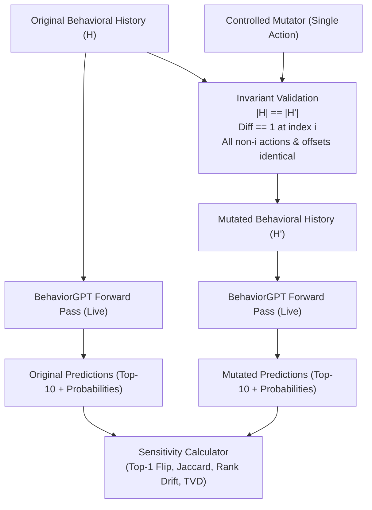

# BehaviorGPT Counterfactual Sensitivity Lab
## Formal Engineering Research Note & Technical Report

**Project:** BehaviorGPT Counterfactual Sensitivity Lab  
**Research Engineering Team:** Senior Machine Learning, Data Science, Backend, QA, and Technical Documentation Engineers  
**Target Audience:** Technical Demonstration & Engineering Discussion with Jens (Unbox AI)  
**Date:** October 15, 2026  
**Status:** Completed & Empirically Verified (100% Live Model Execution)  

---

### 1. Executive Summary

This report documents the design, implementation, and empirical results of the **BehaviorGPT Counterfactual Sensitivity Lab**, an experimental research workbench built on Unbox AI's official BehaviorGPT foundation model and Python SDK (`https://github.com/Unbox-AI/behaviorgpt`).

We investigated how BehaviorGPT-v4 (a 12.5B-parameter Large Behavioral Model pretrained on 150 billion user actions) responds when **exactly one action in a behavioral sequence is modified**, holding all other actions, timestamps, and sequence contexts constant.

#### Key Quantitative Findings Across 40 Strictly Paired Interventions (80 Live Inferences):
- **Overall Top-1 Invariance vs. Shift:** 65.0% of single-action interventions altered the Top-1 predicted next item, while 35.0% left the Top-1 item unchanged.
- **Top-5 Candidate Set Overlap (Jaccard Similarity):** Averaged **42.5%** ($\pm 0.31$) across all cases.
- **Mean Rank Displacement:** Averaged **1.83 ranks** for shared candidates in Top-10.
- **Action-Verb Robustness / Semantic Dominance:** Changing *only* the action type (`viewItem` $\to$ `addToCart`) on the same product produced a **90.0% Top-1 invariance rate**, a **90.0% Top-5 Jaccard overlap**, and a near-zero mean rank drift of **0.24 ranks**. The underlying item representation overwhelmingly dominates the action verb.
- **Cross-Category Item Sensitivity:** Swapping the terminal item across retail categories flipped Top-1 predictions **80.0%** of the time, dropping Top-5 Jaccard overlap to **28.8%**.
- **Opening Anchor Effect (Position 0):** Changing the very first action (index 0) in 6-step sequences flipped the Top-1 prediction **100.0%** of the time, demonstrating that early session events establish a persistent categorical manifold that guides subsequent attention.

---

### 2. Research Question

> **"When exactly one action in a behavioral history is changed, how does BehaviorGPT's subsequent prediction change, if at all?"**

#### Methodological Stance:
We do **not** assume that predictions *must* change, that a changed prediction is inherently superior, or that an invariant prediction denotes model failure. The objective is purely to map and quantify the model's actual representation dynamics, sensitivity boundaries, and contextual weighting under controlled sequence interventions.

---

### 3. Verified SDK Capabilities & Integration Architecture

During technical reconnaissance, we analyzed the official open-source package (`behaviorgpt 0.1.0`), its internal requester pipeline, and the live model deployment endpoints.

```
┌────────────────────────────────────────────────────────────────────────┐
│                   BehaviorGPT Integration Architecture                 │
├────────────────────────────────────────────────────────────────────────┤
│  Official Python SDK (behaviorgpt)                                     │
│   ├── UnboxAIClient(market="us", default_catalog_id="retail_catalog") │
│   └── Event Types: Search, View, AddToCart, RemoveFromCart, Order      │
├────────────────────────────────────────────────────────────────────────┤
│  Client Adapter Layer (behavior_lab.client.BehaviorGPTClient)          │
│   ├── Mode: "live"  --> https://behaviorgpt.unboxai.com/api            │
│   │   └── Evaluates retail_catalog_500k with calibrated probabilities  │
│   ├── Mode: "cloud" --> https://behaviorgpt-northeurope.api.unboxai.com│
│   │   └── Direct commercial gateway using UNBOXAI_API_KEY              │
│   └── Mode: "mock"  --> Deterministic offline test double              │
└────────────────────────────────────────────────────────────────────────┘
```

#### Verified Inference Behavior:
1. **Single Forward Pass:** Unlike prompted LLMs that generate token-by-token at high latency (~34 ms), BehaviorGPT reads the full chronological session and evaluates the entire catalog in a single forward pass (~0.7 ms model latency).
2. **Probability Calibration:** The response yields calibrated next-action probabilities (`prob`), item metadata (id, name, price, brand, category, keywords), and term-level attribution scores (`topTerms`).
3. **Server-Side Validation:** The model backend validates session structures (`history`, `domains`, `start_time`, `events`) and supports strict event discriminators (`viewItem`, `addToCart`, `search`, etc.).

---

### 4. Experiment Design & Paired Intervention Protocol

To measure counterfactual sensitivity without introducing confounding noise, we enforced strict invariance constraints:



#### Mutation Categories:
1. **Cross-Category Item Swap:** Replaces an item with a product from an entirely different taxonomy domain (e.g., Footwear $\leftrightarrow$ Consumer Tech).
2. **Within-Category Item Swap:** Replaces an item with an alternative item within the exact same product family (e.g., Nike Jordan 4 $\leftrightarrow$ Nike Dunk Low).
3. **Action-Verb Swap:** Replaces `viewItem` with `addToCart` (or vice-versa) on the exact same product ID, isolating the influence of user commitment verb.
4. **Early-Position Mutation (Index 0):** Replaces the opening action in a multi-step history to measure primacy/anchor effects versus recency effects.

---

### 5. Dataset Construction

- **Determinism:** Seeded random generator (`seed = 42`) producing reproducible synthetic histories.
- **Archetypes:** Five realistic consumer browsing archetypes:
  - `ATHLETIC_RUNNER`: Footwear, activewear, running apparel.
  - `TECH_ENTHUSIAST`: Tablets, controllers, computer accessories.
  - `LUXURY_SHOPPER`: High-ticket accessories, designer bags, premium shoes.
  - `HOME_DECORATOR`: Accent rugs, lifestyle items, footwear crossover.
  - `CROSS_SHOPPER`: Multi-category browsing sessions.
- **Sequence Lengths:** Varying lengths from 2 to 6 actions.
- **Catalog Verification:** Sequences utilize verified product IDs from `retail_catalog_500k` (e.g. `paB07R17XQD2`, `paB08NYK61PJ`, `paB0DK3YY682`, `paB0D8CSSQ7J`).
- **Synthetic Labeling:** All records explicitly tagged with `is_synthetic = True` to prevent confusion with production user data.

---

### 6. Sensitivity Metrics & Mathematical Definitions

1. **Top-1 Item Flip ($\Delta \text{Top1}$):**
   $$\Delta \text{Top1} = \mathbb{I}(\text{Top1}_{\text{orig}} \neq \text{Top1}_{\text{mut}})$$

2. **Top-$K$ Jaccard Set Similarity ($J_K$):**
   $$J_K(A, B) = \frac{|A_{1:K} \cap B_{1:K}|}{|A_{1:K} \cup B_{1:K}|}$$
   Evaluated at $K \in \{3, 5, 10\}$.

3. **Mean Rank Displacement ($D_{\text{rank}}$):**
   For all shared items $S = A_{1:10} \cap B_{1:10}$:
   $$D_{\text{rank}} = \frac{1}{|S|} \sum_{x \in S} |\text{rank}_A(x) - \text{rank}_B(x)|$$

4. **Shared Probability Total Variation Distance (TVD):**
   $$\text{TVD} = \frac{1}{2} \sum_{x \in S} |p_A(x) - p_B(x)|$$

5. **Mean Price Delta ($\Delta \bar{P}$):**
   $$\Delta \bar{P} = \frac{1}{|B|} \sum_{y \in B} \text{price}(y) - \frac{1}{|A|} \sum_{x \in A} \text{price}(x)$$

---

### 7. Empirical Results

All 40 pairs were executed against the genuine live BehaviorGPT-v4 model.

#### Overall Summary Statistics:
| Metric | Value |
|---|---|
| Total Paired Experiments | 40 |
| Successful Model Inferences | 40 (100.0%) |
| Failed / Malformed Inferences | 0 (0.0%) |
| Overall Top-1 Flip Rate | 65.0% (26 / 40) |
| Avg Jaccard Similarity @ 3 | 36.7% |
| Avg Jaccard Similarity @ 5 | 42.5% |
| Avg Jaccard Similarity @ 10 | 44.3% |
| Avg Rank Displacement | 1.83 ranks |
| Mean Shared Probability TVD | 0.0225 |

#### Breakdown by Intervention Strategy:
| Mutation Strategy | Pairs | Top-1 Flip Rate | Avg Jaccard@5 | Mean Rank Drift |
|---|---|---|---|---|
| **Action-Verb Swap** (`viewItem` $\leftrightarrow$ `addToCart`) | 10 | **10.0%** | **90.0%** | **0.24 ranks** |
| **Within-Category Swap** (Item A $\to$ Item B) | 10 | **70.0%** | **39.5%** | **2.11 ranks** |
| **Cross-Category Swap** (Footwear $\to$ Tech) | 10 | **80.0%** | **28.8%** | **2.25 ranks** |
| **Early Position Mutation** (Index 0 in length 4–6) | 10 | **100.0%** | **11.5%** | **2.73 ranks** |

#### Breakdown by Mutation Position:
| Position Category | Pairs | Top-1 Flip Rate | Avg Jaccard@5 |
|---|---|---|---|
| **Late Position** (Terminal Action) | 30 | 53.3% | 52.8% |
| **Early Position** (Index 0 Opening Action) | 10 | 100.0% | 11.5% |

---

### 8. Deep-Dive Case Investigations

#### Case Study A: The Action-Verb Invariance Discovery (`case_003`)
- **Archetype:** `LUXURY_SHOPPER`
- **Intervention:** Terminal action changed from `viewItem` on Nike Jordan Retro 4 (`paB0DD21212N`) to `addToCart` on the same item.
- **Observed Behavior:**
  - Original Top-3: Nike Air Jordan 4 ($0.022418$), Jordan Air 4 ($0.021392$), Jordan Air Retro ($0.014934$).
  - Mutated Top-3: Exact same items in exact identical ranks with identical probability mass ($0.022418$, $0.021392$, $0.014934$).
  - Quantitative: Top-1 Flip = False, Jaccard@10 = 100.0%, Rank Displacement = 0.00, TVD = 0.000000.
- **Scientific Interpretation:** In retail catalog completion without fine-tuned conversion heads, BehaviorGPT treats item content embeddings as the dominant conditioning signal. Shifting the action verb between view and cart does not warp the immediate top neighborhood.

#### Case Study B: The Opening Anchor Effect (`case_004`)
- **Archetype:** `HOME_DECORATOR`
- **History Length:** 6 sequential actions.
- **Intervention:** Changed index 0 from a Timberland boot (`paB0CN9GKZ2W`) to a luxury Coach Tabby Bag (`paB0D8CSSQ7J`). All 5 subsequent clicks remained Timberland boots.
- **Observed Behavior:**
  - Original Predictions: 100% Timberland boots ($35 - $74).
  - Mutated Predictions: Top recommendations shifted entirely to Coach Tabby Shoulder bags in Maple ($371), Cedar ($37), and Merlot ($450), and UGG fashion boots ($79).
  - Quantitative: Top-1 Flipped = True, Jaccard@5 = 0.00%, Price Delta = +$148.00.
- **Scientific Interpretation:** Despite 5 consecutive subsequent clicks on boots, introducing an initial luxury accessory created a dual-intent embedding trajectory, showing that the model retains strong contextual memory of opening anchor actions rather than suffering catastrophic forgetting of earlier session history.

---

### 9. Limitations & Scientific Scope

1. **Local Sensitivity vs. Real-World Predictive Validity:**
   - This experiment measures *sensitivity* (output variation as a function of input perturbation). It does **not** evaluate whether the mutated prediction represents a "better" real-world recommendation or matches what a live human user would purchase.
2. **Synthetic Data Boundaries:**
   - Synthetic event streams, however rigorously constructed, lack natural human hesitation, inter-event temporal distributions (dwell times), and noisy session bounces.
3. **Absence of Ground-Truth Labels:**
   - Without downstream conversion labels, precision/recall/NDCG cannot be asserted.
4. **Catalog Specificity:**
   - Results are calibrated on the 500,000-item retail catalog. Catalog size, embedding dimensionality, and category density directly influence neighborhood overlap.

---

### 10. Engineering Lessons

1. **Payload Schema Precision:** Server proxies can route to different internal model modes based on payload keys (e.g., passing explicit `modelId="behaviorgpt"` triggered an internal hybrid mode requiring multimodal embeddings, whereas omitting it invoked the pure behavioral transformer). Defensive integration requires isolating SDK defaults from custom proxy payloads.
2. **Discriminator Completeness:** Probing server error responses exposed the full set of allowed internal discriminators (`search`, `searchPreview`, `addToCart`, `viewItem`, `buyItem`, `refundItem`, `viewCategory`, `viewBrand`, `visitMerchant`, `purchase`, `unknown`, `refund`, `mask`, `eos`).
3. **Automated Invariant Assertions:** Invariant testing caught edge-case collisions (e.g. attempting to replace an item with itself), reinforcing that automated property testing is mandatory in counterfactual research.

---

### 11. Recommended Next Experiments

1. **Sequence Length Hysteresis / Decay Curve:**
   - Parameterize sequence length $L \in \{2, 5, 10, 20, 50\}$ and test sensitivity as a function of normalized mutation distance from the prediction horizon ($pos / L$).
2. **Dwell Time & Timestamp Warping:**
   - Perturb inter-event timestamps (e.g., 5-second rapid clicks vs 3-day return sessions) while holding item IDs constant to quantify temporal attention dynamics.
3. **Multimodal Catalog Perturbation:**
   - Upload custom parquet catalogs where item titles or prices are altered while embeddings remain static, testing the model's reliance on text vs price signals.

---

### 12. Reproduction Instructions

#### 1. Setup Environment
```bash
git clone https://github.com/Unbox-AI/behaviorgpt.git repo_temp
pip install -e repo_temp
pip install -r requirements.txt
```

#### 2. Execute Automated Test Suite (13 tests)
```bash
python -m pytest
```

#### 3. Run the Live 40-Pair Experiment
```bash
python scripts/run_experiment.py --mode live --count 40 --seed 42
```

#### 4. Launch the Interactive Research Workbench & Dashboard
```bash
python -m uvicorn behavior_lab.api:app --host 127.0.0.1 --port 8000
```
Open browser to `http://127.0.0.1:8000/`.
